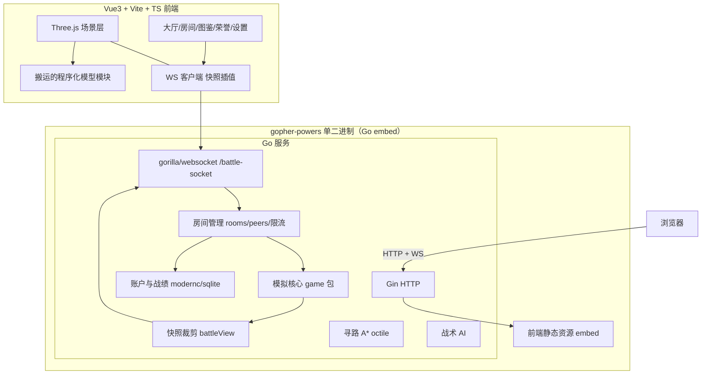

# GopherPowers 重写方案（great-powers-rts → Go）

> 源项目：https://github.com/chencheng666/great-powers-rts （「大国崛起」v1.0.0，红警风格 RTS）
> 目标仓库：https://github.com/cnyup/gopher-powers.git
> 本文档基于对源码的实地勘察（2026-10-14，main @ c3b0d54），所有规模数字均为实测。

## 一、源项目勘察结论

### 1.1 架构事实

源项目是**服务端权威模拟**架构：

- 模拟核心 `src/game.js`（Game 类，1383 行）+ 17 个依赖模块（共约 2900 行 JS），**已验证零浏览器依赖**（无 three/document/window/navigator 引用），单机与服务端共用同一份模拟代码。
- 对战服务端 `server/*.mjs`（332 行）：Node http + ws，直接 import `game.js` 跑权威模拟，客户端只发指令、收 JSON 快照。
- 前端 Three.js 渲染 + 40 余个程序化模型/特效模块（约 4700 行），视觉层与模拟层通过快照 JSON 解耦。
- 测试 42 个文件 / 约 3920 行（node:test），大量针对模拟规则——是移植正确性的现成验收基准。

### 1.2 规模实测

| 部分 | 文件 | 行数 | 说明 |
| --- | --- | --- | --- |
| 模拟核心 | src/game.js | 1383 | Game 类：tick 主循环、生产、战斗、AI |
| 模拟依赖 | data/unit-spacing/tactical-ai/modern-combat 等 17 个 | ~1514 | 规则数据与子系统 |
| 对战服务端 | server/*.mjs | 332 | 房间、账户、限流、快照广播 |
| 协议 | network-protocol.js | 47 | v2(双人)/v3(六方) |
| 联机客户端 | online-client/online-game | ~260 | WS 重连、快照插值 |
| 3D 前端 | render.js/main.js + 视觉模块 | ~4700 | Three.js、程序化模型 |
| 测试 | test/*.test.js ×42 | ~3920 | 规则回归 |
| 桌面 | Tauri 2 配置 | — | 五平台打包 |

### 1.3 关键运行参数（实测自代码）

- 模拟 tick：50ms（20Hz），`game.update(0.05)`，dt 钳制 `[0, 0.05]`。
- 快照频率：双人每 2 tick（10Hz），六方每 4 tick（5Hz）。
- 寻路：`pathfinding` npm 的 `AStarFinder({allowDiagonal, dontCrossCorners, octile})` + `compressPath`，网格 cell=40，世界 2240×1440。
- 迷雾刷新节流 0.22s；兵种数据：5 阵营 / 8 地图 / 33 单位 / 12 建筑 / 3 胜利模式。
- WS 限制：maxPayload 16KB，令牌桶 40 token、恢复速率 0.02/ms（≈20 msg/s），peer 上限 64，双人房间 20 个、并发战局 4（六方 1）。
- 单位上限：每玩家 120（单位+生产队列），六方每席 40。
- 存储：`node:sqlite`（SQLite WAL），`server-data/guests.sqlite`，4 张表：guests / matches / multi_matches / match_members。单机存档在浏览器 localStorage，不落库。

## 二、已确认的技术选型（用户拍板）

| 决策点 | 选型 | 备注 |
| --- | --- | --- |
| 重写范围 | **后端 Go + 新 Web 前端** | 前端用新框架重构，不逐行翻译旧前端 |
| 协议 | **完全兼容现有 JSON 协议** | v2/v3 逐字段兼容，Go 服务端可被现有前端连上（对拍锚点） |
| HTTP/WS | **Gin + gorilla/websocket** | |
| 存储 | **modernc.org/sqlite（纯 Go）** | 表结构与现有 guests.sqlite 兼容，可直接迁移历史数据 |
| 单机模式 | **单二进制包**：本地起 Go 服务，浏览器打开选单机/联机 | 单机模拟跑在本地服务端进程内，无需 WASM；WASM 列为二期可选（若将来要恢复零安装纯静态离线包） |
| 前端框架 | **Vue 3 + Vite + TypeScript** | |
| 3D 资产 | **搬运现有程序化模型代码** | 40+ 个 ES module 平移进新前端，视觉 100% 保真 |
| 桌面端 | **保留 Tauri 2 壳** | 新前端就绪后接入，继承五平台 CI 与国产系统适配 |

## 三、目标架构



要点：

1. **模拟核心是纯 Go 包**（`internal/game`），不依赖 net/http——单机（本地服务进程内跑打 AI）与联机（远程服务端跑）走同一份代码，规则一致性由构造保证。
2. **单二进制形态**：`go build` 产出含 embed 前端的一个可执行文件；启动后浏览器打开，首页选「单机遭遇战」（本地模拟）或「联机对战」（该进程就是主机，或填远端地址当客户端）。LAN 联机 = 其他人直连主机玩家的二进制进程（对应源项目 server:lan 形态）。
3. **协议逐字段兼容**：Go 服务端消息格式与源项目 v2/v3 完全一致（含房间码、迷雾 base64 打包、席位重排视角裁剪），这是移植期的对拍验证锚点——旧 JS 前端可直接连 Go 服务端，差异即 bug。

## 四、模块映射（JS → Go）

| 源模块 | 行数 | → Go 包 | 移植策略 |
| --- | --- | --- | --- |
| src/game.js | 1383 | internal/game | 逐方法翻译，保留 tick 阶段顺序 |
| src/data.js | 190 | internal/game/data | 数据表直译（5 阵营/8 地图/33 单位/12 建筑） |
| src/unit-spacing.js | ~100 | internal/game/spacing | 阵型偏移、分离、空间索引（网格分桶） |
| src/tactical-ai.js | ~90 | internal/game/ai | AI 反制配额、撤退 |
| src/tactical-rules.js | ~80 | internal/game/rules | 战术伤害修正 |
| src/modern-combat.js | 496 | internal/game/combat | 电子战/现代支援 |
| src/savegame.js | 170 | internal/game/savegame | 存档 schema/校验（SNAPSHOT_FIELDS） |
| src/logistics-economy.js | ~120 | internal/game/logistics | 后勤经济 |
| src/lunar-robots.js | ~110 | internal/game/lunar | 月表机器人 |
| src/intelligence.js | ~90 | internal/game/intel | 间谍/情报 |
| src/battle-report.js | ~100 | internal/game/report | 13 项战后指标 |
| src/battlefield-expansion/details、equipment、unit-specs、bridge-fire、six-player-map、battle-identity | ~600 | internal/game/… | 同名子包 |
| pathfinding (npm) | — | internal/game/pathfind | **Go 自实现** A*：allowDiagonal + dontCrossCorners + octile + 路径压缩，语义对齐 |
| server/index.mjs | 186 | internal/server | Gin 路由 + 房间状态机 + 50ms ticker + 令牌桶 |
| server/accounts.mjs | 37 | internal/store | modernc/sqlite，表结构兼容 |
| server/commands.mjs | 36 | internal/server/command | 16 个指令白名单原样照搬 |
| server/battle-view.mjs | 49 | internal/server/view | 视角裁剪 + 记忆机制（memory Map） |
| src/network-protocol.js | 47 | internal/protocol | roomCode/nickname 校验、packFog/unpackFog |
| src/online-client.js + online-game.js | ~260 | 前端 src/net/ | TS 重写（WS 重连、快照插值 0.8 版已验证） |
| render.js/main.js + 视觉模块 ×40 | ~4700 | 前端 src/scene/ | Three.js 代码平移 + Vue 胶水层 |

## 五、兼容性契约（协议冻结面）

Go 服务端必须逐字段复刻以下行为（以源码为准绳）：

**HTTP**：`/api/health`、`/api/session`（GET/POST 昵称、cookie `gp_guest`/`gp_six_guest`、HttpOnly+SameSite=Lax+Path 区分、30 天过期、IP 限流 30 次/分钟）；静态文件路径穿越防护、/official /downloads 重定向。

**WS 消息（客户端→服务端）**：`create / join / observe / leave / ping / set-ai / ready / faction / start / command(seq 单调递增)`。

**指令白名单（command.action）**：`build, cancel-build, place, train, cancel-train, repair, sell, rally, resupply, unload, auto-supply, group-resupply, group-unload, ability, satellite, cyber, move, stop`（+`mode:'patrol'`、`attackMove:true` 变体），selected 上限 120。

**服务端→客户端**：`hello / room / battle / snapshot / ack / pong / error`。

**快照裁剪规则**（battleView）：席位重排（视角方恒为 side 0）、敌方单位剥离指令/队列/乘客/弹药、建筑记忆机制（消失后保留最后已知状态）、资源点不可见时 owner 置 null 且 amount 显示 max、弹道裁剪起终点、迷雾 2bit/cell base64 打包。

**错误文案**：逐字复刻（「请输入六位数字房间码」「昵称请使用 1 到 16 个可显示字符」等）——前端有逐字节断言。

## 六、分期计划

| 期 | 内容 | 验收 |
| --- | --- | --- |
| **M1 模拟核心** | internal/game 全量移植 + pathfind + Go 单测（移植源项目 42 个测试文件中的模拟规则断言） | `go test ./internal/game/...` 全绿；关键战斗/生产/经济场景与 JS 版输出对拍 |
| **M2 服务端** | Gin + WS + 房间 + 账户 + 快照裁剪 + 限流 | **旧 JS 前端直连 Go 服务端**完整打一局双人（协议对拍）；curl/health、会话、房间流转全通 |
| **M3 新前端** | Vue3 + TS 脚手架、大厅/房间/战局 HUD、Three.js 场景层 + 模型模块平移、WS 客户端 | 新前端连 Go 服务端打完整局；单机模式（本地进程）可玩；视觉与旧版对照无回归 |
| **M4 二进制化与桌面** | go:embed 前端、单二进制构建、LAN 模式、Tauri 2 壳接入 | 双机 LAN 对战；五平台桌面打包；发布 CI |
| **M5 收尾** | 数据迁移工具（guests.sqlite → 新库）、文档、性能验证（六方密集交战） | 六方 40 单位/席压测；迁移脚本验证 |

对拍验证是贯穿手段：M2 起每个快照字段都可与 Node 服务端输出 diff。

## 七、风险与对策

| 风险 | 对策 |
| --- | --- |
| JS 动态语义（浮点、undefined 遍历、字段缺省）在 Go 中行为漂移 | 对拍测试：同指令序列分别喂 JS/Go 模拟，diff 快照 JSON；浮点运算保持 float64、逐处核对 Math.* 与 Go math 对应关系 |
| 视角裁剪/记忆机制细节多（潜艇 surfaced、破坏归属、指令目标可见性） | battleView 独立单测 + 旧前端连真实对局验证 |
| 六方模式复杂度高（淘汰、观战、断线宽限、房主交接） | M1/M2 先双人（协议 v2），六方（v3）作为 M2 末段子项 |
| 模型模块依赖旧前端的全局结构 | 模型模块多为纯 THREE.Mesh 工厂函数，平移时以 adapter 注入依赖；逐模块渲染截图对照 |
| pathfinding npm 行为差异 | 用源项目测试向量做黄金用例（同一网格同一障碍 → 相同压缩路径） |

## 八、仓库结构（目标）

```
gopher-powers/
├── cmd/gopher-powers/        # 单二进制入口
├── internal/
│   ├── game/                 # 模拟核心（纯 Go，无 net/http 依赖）
│   │   ├── data/  ai/  combat/  pathfind/  …
│   ├── server/               # Gin + WS + 房间 + 快照
│   ├── store/                # modernc/sqlite 账户与战绩
│   └── protocol/             # 消息定义与校验
├── web/                      # Vue3 + Vite + TS 前端
│   ├── src/scene/            # Three.js + 平移的模型模块
│   ├── src/net/              # WS 客户端
│   └── src/ui/               # 大厅/房间/HUD 组件
├── docs/                     # 本文档与后续设计文档
└── .github/workflows/        # CI（构建/测试/发布）
```

构建环境：远程主机 avl-pro5000 已装 Go 1.26.8（linux/amd64，实测）。
